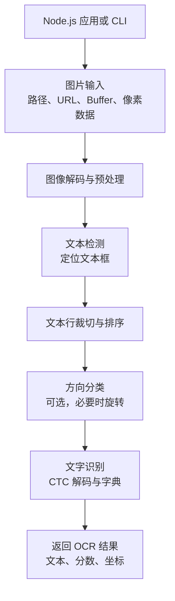

# RapidOCR Node

面向 Node.js 的 RapidOCR 实现，按 [RapidOCR](https://github.com/RapidAI/RapidOCR) 的模型路由和 OCR 流程处理文本检测、方向分类与文字识别。推理使用 [ONNX Runtime Node](https://github.com/microsoft/onnxruntime)，默认在 CPU 上运行。

[](https://github.com/OSpoon/RapidOCRNode/actions/workflows/ci.yml)
[](https://www.npmjs.com/package/rapidocr-node)
[](./LICENSE.md)

## 安装

```sh
npm install rapidocr-node
```

需要 Node.js 24 或更高版本。首次 OCR 会按所选模型路由下载所需 ONNX 模型和识别字典，校验 SHA-256 后放入本机缓存；npm 安装和实例创建本身不会下载模型。模型可预先用 `downloadModels()` 下载，也可指定本地模型路径。

CPU 是默认执行提供程序。可通过 `executionProviders` 配置 ONNX Runtime 执行提供程序；是否可用取决于当前 `onnxruntime-node` 构建、操作系统和硬件。不可用的提供程序会发出警告并回退到 CPU。

## 快速开始

```ts
import { RapidOCR } from 'rapidocr-node'

const ocr = await RapidOCR.create()
try {
  const result = await ocr.recognize('./receipt.jpg')
  console.log(result.lines)
}
finally {
  await ocr.close()
}
```

输入支持本地路径、HTTP(S) URL、`URL`、`Buffer` / `Uint8Array`、`ArrayBuffer`、`Blob`，以及带尺寸和像素格式的原始图像数据。默认执行检测、方向分类和识别。完整结果保留上游字段 `img`、`boxes`、`txts`、`scores`、`word_results`、`elapse_list` 和 `elapse`；`boxes` 是 `[N][4][2]` 坐标数组，`img` 是带 `width`、`height`、`format: 'BGR'` 的像素对象。Node 便利字段 `lines`、`boxPoints`、`wordResults`、`elapseList` 和 `timings` 也可用。`to_json()`、`to_markdown()` 和 `vis()` 使用上游方法名；`toJSON()`、`toMarkdown()` 与 `visBuffer()` 是 Node 风格扩展。

```ts
const result = await ocr.recognize({
  data: bgrPixels,
  format: 'BGR24',
  width,
  height,
  stride: width * 3,
})
```

## 工作流程

RapidOCR Node 从图片输入开始，依次完成文本检测、文本行识别并返回带位置的结果：



检测、方向分类和识别使用 ONNX Runtime 推理，并在各阶段按需加载模型。未提供本地模型时，程序检查本机缓存；默认模型或识别字典缺失时自动下载，校验 SHA-256 后存入缓存。CPU 为默认执行提供程序，也可配置当前环境可用的执行提供程序。

## 模型

模型路由对应 RapidOCR v3.10.0 的 `default_models.yaml`，覆盖 PP-OCRv4、PP-OCRv5 和 PP-OCRv6 中上游登记的 ONNX 检测、分类及识别模型。默认使用 PP-OCRv6 small 中文检测和识别模型，以及 PP-OCRv4 mobile 方向分类模型。可用语言通过 `listSupportedLanguages(stage, version, modelType?)` 查询。

识别字典会与所选识别模型一同下载。模型和字典的来源、许可说明及完整 SHA-256 清单见 [`MODEL-LICENSES.md`](./MODEL-LICENSES.md) 和源码模型注册表。

## API 和 CLI

```ts
import { downloadModels, listSupportedLanguages, RapidOCR } from 'rapidocr-node'

const paths = await downloadModels()
console.log(paths)
console.log(listSupportedLanguages('rec', 'PP-OCRv5', 'mobile'))

const ocr = await RapidOCR.create({
  executionProviders: ['cpu'],
  returnWordBoxes: true,
})
```

命令行提供图片识别、配置生成、模型下载、语言查询和安装检查：

```sh
rapidocr-node receipt.jpg
rapidocr-node receipt.jpg --output markdown --vis
rapidocr-node config --save-config rapidocr.yaml
rapidocr-node download-models
rapidocr-node check
rapidocr-node --list-langs --task rec --ocr-version PP-OCRv5 --model-type mobile
```

也可以用 CLI 管理 HTTP API 服务。`start` 会在后台启动，并等到模型预热、服务可用后返回；`run` 在前台运行。默认只监听本机 `127.0.0.1:8000`：

```sh
rapidocr-node serve start --port 8000
rapidocr-node serve status
rapidocr-node serve restart
rapidocr-node serve stop

# 前台运行，按 Ctrl-C 优雅停止
rapidocr-node serve run --host 127.0.0.1 --port 8000
```

服务提供 `GET /health/live`、`GET /health/ready`、`GET /openapi.json` 和 `POST /v1/ocr`。OCR 接口接收 `multipart/form-data`，图片使用 `file` 字段；可选 `options` 字段是 JSON 字符串，支持 `box_threshold`、`unclip_ratio`、`text_score_threshold`、`return_word_boxes`、`return_single_char_boxes` 和 `include_image`。上传大小默认限制为 10 MiB，并发 OCR 默认限制为 1；可通过 `--max-file-size` 和 `--max-concurrency` 调整。

```sh
curl http://127.0.0.1:8000/health/ready
curl -X POST http://127.0.0.1:8000/v1/ocr \
  -F 'file=@receipt.jpg' \
  -F 'options={"return_word_boxes":true,"include_image":false}'
```

JSON 响应保留 RapidOCR 字段名：`boxes`、`txts`、`scores`、`word_results`、`lang_rec`、`elapse_list` 和 `elapse`。若包含图像，`img.data` 是 base64 编码的 BGR 像素，另带 `encoding`、`format`、`width` 和 `height`。错误响应遵循 Problem Details JSON 格式。服务只接受上传图片，不接受客户端提供的本地路径或 URL。

CLI 参数和配置文件可通过以下命令查看：

```sh
rapidocr-node --help
rapidocr-node config --help
rapidocr-node serve --help
```

## 开发和验证

```sh
pnpm install
pnpm run ci
pnpm run test:e2e
pnpm run test:models
```

`test:e2e` 对照 RapidOCR v3.10.0 固定参考验证完整流程。`test:models` 使用真实图片验证上游登记的 42 个 ONNX 阶段模型路由及 30 个识别路由的整页结果；可选执行提供程序需在匹配的系统和硬件上单独验证。覆盖范围和待完成事项见 [`ROADMAP.md`](./ROADMAP.md)。

## 许可

本项目代码按 Apache-2.0 许可发布。RapidOCR 上游代码、模型、字典、字体和测试图片分别保留其上游许可与归属信息；详见 [`NOTICE.md`](./NOTICE.md) 和 [`MODEL-LICENSES.md`](./MODEL-LICENSES.md)。本项目不是 RapidOCR 官方发行版。
